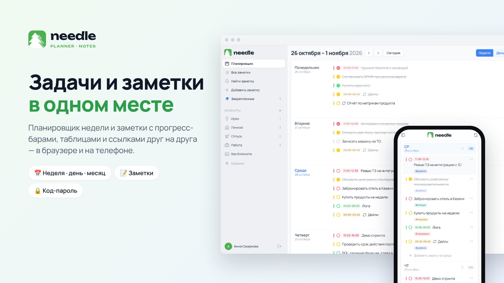
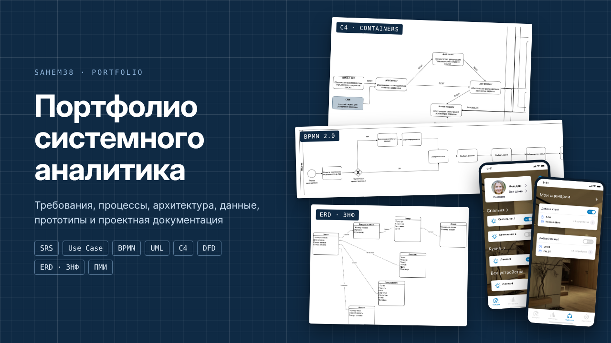

# Александр Емельянов

**Системный аналитик | System Analyst**

*Веду проекты разработки от формирования требований до ввода системы в эксплуатацию*

---

## Обо мне

Ведущий системный аналитик в различных проектах импортозамещения. Шесть лет веду продукты от сбора, документирования и формирования реестра требований до сопровождения тестирования и ввода в эксплуатацию программного продукта (взаимодействие с подрядчиками, сдача результатов работ заказчикам, презентация продуктов клиентам). До этого пять лет был инженером-конструктором - отсюда привычка к точным формулировкам и стандартам.

- **Сейчас:** Создал и развиваю [Needle](https://github.com/Sahem38/needle-app) - планировщик задач и менеджер заметок

## Навыки и инструменты

| **Анализ требований** | User Story, User Story Mapping, Use Case, Gherkin, спецификации, реестр требований |
| **Моделирование** | UML, BPMN, DFD, ER-диаграммы, C4, моделирование данных |
| **Проектирование API** | REST, Swagger / OpenAPI, Postman |
| **Документирование** | ТЗ по ГОСТ 34, ГОСТ 19, ПМИ, руководства пользователя |
| **Базы данных** | SQL, PostgreSQL, MySQL |
| **Процессы и ALM** | Agile, Devprom, Camunda, приёмочное тестирование |
| **Инструменты** | Git, GitLab, GitHub, Figma, Miro, draw.io |
| **ИИ в работе** | Claude, ChatGPT, DeepSeek и др. - погружение в предметную область, проверка требований на полноту, ТЗ для ИИ-агентов, черновики документации |

## Проекты

<table>
  <tr>
    <td width="50%" valign="top">
      
       
      <a href="https://github.com/Sahem38/needle-app"><b>Needle</b></a>
       
      Планировщик задач и менеджер заметок
    </td>
    <td width="50%" valign="top">
      
       
      <a href="https://github.com/Sahem38/system-analyst-portfolio"><b>Системный аналитик</b></a>
       
      Артефакты работы системного наалитика
    </td>
  </tr>
</table>
